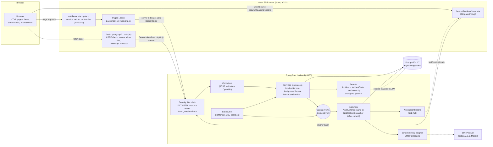
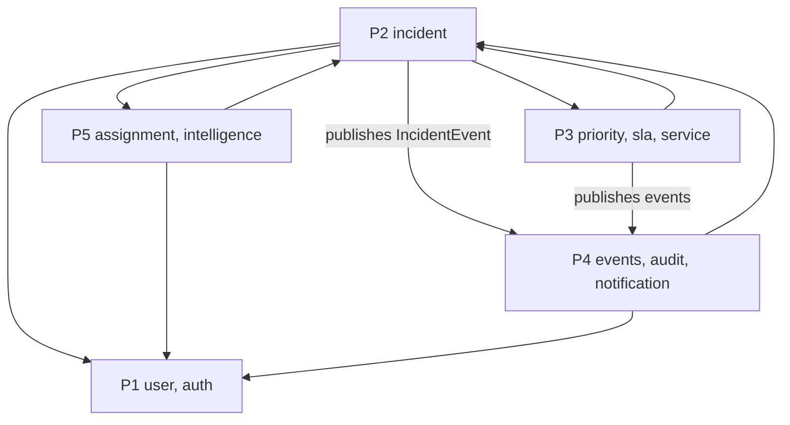
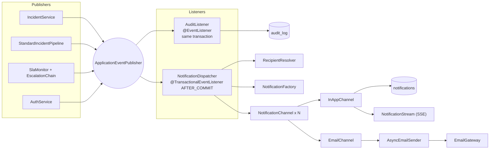
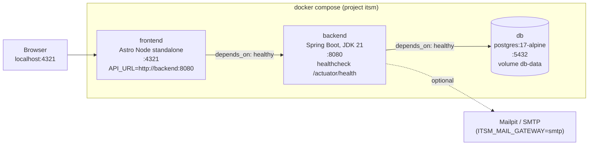

# 3. System Architecture

## 3.1 Overview

I-ITSM is a three-tier web application: a server-rendered **Astro** frontend, a **Spring Boot (Kotlin)** REST
backend and a **PostgreSQL** database. The browser only ever talks to the Astro server (one origin), which renders
pages and forwards `/api/**` calls to the backend. Inside the backend, business logic sits in domain classes and
services; modules talk to each other through **domain events** rather than direct calls where possible.



Key properties of the picture:

* The JWT lives in an **httpOnly, SameSite=Lax cookie** set by the Astro server. Browser JavaScript never sees it; Astro
  turns it into an `Authorization: Bearer` header for the backend.
* The **backend has no sessions**: it is a stateless resource server. Revocation works through a per-user
  `token_version` that the security converter compares on every request.
* **Audit rows are written in the publisher's transaction; notifications after commit.** Nothing is notified for an
  action that rolled back, and an action cannot succeed without its audit row.
* The SLA monitor and the SSE heartbeat are the only background threads that start work on their own.

## 3.2 Layers and the module map

The code was written by five people as five modules, **P1 to P5**, each a set of packages under `com.itsm`.
They meet at small contracts (interfaces, DTOs, events), which is why the modules are loosely coupled.

| Module | Responsibility | Packages | Main classes |
|---|---|---|---|
| **P1 Users and security** | Accounts, roles, authentication, sessions, admin user API | `user`, `auth`, `config`, `common.exception`, `web` | `User`, `Employee`, `Technician`, `Administrator`, `UserFactory`, `AuthService`, `JwtTokenService`, `LoginAttemptTracker`, `SessionRevoker`, `SecurityConfig`, `GlobalExceptionHandler` |
| **P2 Incidents** | Incident domain, lifecycle, report pipeline, REST API, categories, demo data | `incident`, `category`, `demo` | `Incident`, `IncidentState`, `IncidentService`, `IncidentProcessingPipeline`, `StandardIncidentPipeline`, `IncidentController`, `CategoryService`, `DemoDataSeeder` |
| **P3 Service catalog, priority, SLA** | IT services, priority strategies, SLA policies, monitoring, escalation, settings | `service`, `priority`, `sla`, `sla.escalation`, `settings` | `ItService`, `ServiceCatalog`, `PriorityService`, `WeightedScoreStrategy`, `MatrixStrategy`, `DefaultSlaService`, `SlaMonitor`, `EscalationChain`, `SettingsService` |
| **P4 Events, notifications, audit, search, reports** | Event contract, audit trail, notifications (in-app, email, SSE), search, reports | `events`, `audit`, `notification`, `notification.channel`, `notification.stream`, `search`, `reports`, `reference` | `IncidentEvent`, `AuditListener`, `NotificationDispatcher`, `NotificationFactory`, `RecipientResolver`, `InAppChannel`, `EmailChannel`, `EmailGateway`, `IncidentSpecifications`, `ReportService` |
| **P5 Assignment and intelligence** | Technician selection, category suggestion, duplicate hints | `assignment`, `intelligence` | `AssignmentService`, `SkillLeastLoadedStrategy`, `RoundRobinStrategy`, `AssignmentStrategySelector`, `KeywordCategorySuggester`, `TokenSimilarityDuplicateDetector` |
| **Frontend** | Pages, proxy, session handling | `frontend/src` | `middleware.ts`, `lib/gate.ts`, `lib/access.ts`, `lib/backend.ts`, `lib/proxy.ts`, `lib/csrf.ts`, `pages/**` |

Dependencies between modules (arrows mean "uses"):



Two deliberate decoupling choices:

* `Incident` references people by **id** (`reporterId`, `assigneeId`), not by entity, so the incident module does
  not depend on the user module's classes.
* P4 maps the P3 tables it needs read-only (`ItServiceRef`, `SlaEventRef` in `reference/ReferenceEntities.kt`)
  instead of importing P3 entities.

Inside each module the layering is the same: **controller (DTO in/out, validation) to service (one transaction per
use case) to domain (rules, invariants) to repository (Spring Data)**.

## 3.3 Request flow: "report an incident"

`POST /api/incidents` by an employee. The pipeline is a **Template Method**: `IncidentProcessingPipeline.process`
is final and fixes the order; `StandardIncidentPipeline` provides the steps.

```mermaid
sequenceDiagram
    autonumber
    actor E as Employee (browser)
    participant A as Astro (proxy)
    participant C as IncidentController
    participant S as IncidentService
    participant P as StandardIncidentPipeline
    participant K as KeywordCategorySuggester
    participant PR as PriorityService
    participant SL as DefaultSlaService
    participant AS as AssignmentService
    participant I as Incident (domain)
    participant EV as Spring events
    participant AU as AuditListener
    participant ND as NotificationDispatcher
    participant DB as PostgreSQL

    E->>A: POST /api/incidents (cookie)
    A->>C: Bearer token, JSON body
    C->>S: report(reporter, request) [@Transactional]
    S->>DB: save Incident (status NEW, number INC-nnnnnn)
    S->>EV: IncidentReported
    EV->>AU: (same transaction) audit row INCIDENT_REPORTED
    S->>P: process(incident, context)
    P->>K: 1. suggestCategory (only if none given, confidence >= 0.5)
    P->>I: 2. classify() NEW to CLASSIFIED (if a category is known)
    P->>EV: IncidentClassified, StatusChanged
    P->>PR: 3. prioritise(impact, urgency, criticality, users, category)
    PR-->>P: PriorityResult (priority, score, explanation)
    P->>I: applyPriority()
    P->>EV: PriorityChanged
    P->>SL: 4. applySla(serviceId, priority, createdAt)
    SL-->>P: SlaDeadlines
    P->>I: applySla()
    P->>AS: 5. assign() (only if CLASSIFIED; reporter excluded)
    AS-->>P: AssignmentResult or null
    P->>I: assign(technician, SYSTEM) CLASSIFIED to ASSIGNED
    P->>EV: IncidentAssigned, StatusChanged
    S->>DB: saveAndFlush(incident)
    S-->>C: IncidentDetail (with actions for the caller)
    C-->>E: 201 Created
    Note over DB,ND: transaction commits
    EV->>ND: after commit (REQUIRES_NEW per recipient and channel)
    ND->>DB: in-app notification rows
    ND-->>E: SSE push (assignee, reporter), email via EmailGateway
```

Important details:

* If no category is given or suggested, steps 2 and 5 are no-ops: the incident stays **NEW** (priority and SLA are still
  calculated) until an administrator classifies it (`POST /api/admin/incidents/{id}/classify`), which re-runs the pipeline.
* If no technician qualifies, the incident stays **CLASSIFIED** until an administrator assigns it.
* Every event is published inside the transaction. `AuditListener` is a plain `@EventListener` (runs in that
  transaction); `NotificationDispatcher` is a `@TransactionalEventListener(AFTER_COMMIT)`.

## 3.4 Event-driven design

The contract is the sealed class `IncidentEvent` (`events/IncidentEvent.kt`); every subtype carries `incidentId`,
`actorId` (null = system) and `occurredAt`. Two login events (`UserLoggedIn`, `LoginFailed` in `auth`) are consumed
by audit only.

| Event | Published by | When | Audit action | Notified |
|---|---|---|---|---|
| `IncidentReported` | `IncidentService.report` | incident created | INCIDENT_REPORTED | reporter |
| `IncidentClassified` | `StandardIncidentPipeline.classify` | NEW to CLASSIFIED | INCIDENT_CLASSIFIED | reporter |
| `PriorityChanged` | `StandardIncidentPipeline.prioritise` | priority set or changed | PRIORITY_CHANGED | assignee |
| `IncidentAssigned` | pipeline, `IncidentService.assign` | technician chosen (strategy name recorded; `manual` for admins) | INCIDENT_ASSIGNED | assignee, reporter |
| `StatusChanged` | every transition | any status change | STATUS_CHANGED (from, to) | see BR-06 |
| `NoteAdded` | `IncidentService.addNote` | note added directly | NOTE_ADDED | see BR-06 |
| `InfoRequested` | `IncidentService.requestInfo` | technician asks a question | INFO_REQUESTED | reporter |
| `IncidentResolved` | `IncidentService.resolve` | RESOLVED | INCIDENT_RESOLVED | reporter |
| `IncidentClosed` | `IncidentService.close` | CLOSED | INCIDENT_CLOSED | reporter, assignee |
| `SlaWarningRaised` | `SlaMonitor` | threshold reached | SLA_WARNING | assignee or admins |
| `SlaBreached` | `SlaMonitor` | deadline passed | SLA_BREACHED | assignee, admins |
| `IncidentEscalated` | `AdminEscalationHandler`, `ReassignEscalationHandler` | escalation step | INCIDENT_ESCALATED | assignee, admins |
| `UserLoggedIn` / `LoginFailed` | `AuthService` | login | USER_LOGGED_IN / LOGIN_FAILED | nobody |



Publisher rules (from `docs/p4.md`): publish `StatusChanged` on every transition; also publish the specific event if
one exists; `actorId` is the user or null for the system; publish inside the `@Transactional` method.

Adding a new consumer (a webhook, a metrics collector) means writing one more listener; no publisher changes.

## 3.5 Scheduled work

| Job | Class | Interval | Purpose |
|---|---|---|---|
| SLA check | `SlaMonitorScheduler.tick` calls `SlaMonitor.runOnce` | `itsm.sla.monitor-interval`, default 60000 ms; can be disabled (`SLA_MONITOR_ENABLED=false`, as in tests) | warnings, breaches, escalation |
| SSE heartbeat | `NotificationStream.heartbeat` | 25 s | keep idle SSE connections alive and drop dead ones |

<!-- TODO(verify after merge): an admin SLA monitor with SLA risk detection (predictive/at-risk view) is being added
by a parallel track; add it here and to the module map once merged. -->

## 3.6 Deployment

`docker-compose.yml` defines three services; only Docker is needed.



* Start order is enforced with health checks: db (`pg_isready`), then backend (`/actuator/health` returns UP), then frontend.
* Flyway runs the migrations when the backend starts; Hibernate only validates the schema.
* Configuration is by environment variables (see the table in the root `README.md`). The backend refuses to start
  without a `JWT_SECRET` of at least 32 bytes; compose supplies an insecure development default.
* `ADMIN_EMAIL` / `ADMIN_PASSWORD` create the first administrator (`AdminBootstrap`); `DEMO_DATA=true` adds demo users
  and incidents (`DemoDataSeeder`, refused under the `prod` profile).
* **CI** (`.github/workflows/ci.yml`) runs on every push to `main` and every pull request: backend
  `./gradlew build` (JDK 21, Testcontainers PostgreSQL on the runner) and frontend `pnpm check`, `pnpm test`,
  `pnpm build` (Node 24, pnpm).

## 3.7 Scaling considerations

The design is single-node today. Three pieces of state are in memory: the SSE emitters (`NotificationStream`), the
login throttle (`LoginAttemptTracker`) and the round-robin pointer (`RoundRobinStrategy`). The SLA monitor would
need row locking if several nodes ran it. Moving these to PostgreSQL or Redis, running several stateless backend
instances behind a load balancer and giving the SSE hub a pub/sub backbone is the evolution path
(see [06-technology-stack.md](06-technology-stack.md), section 6.4).
