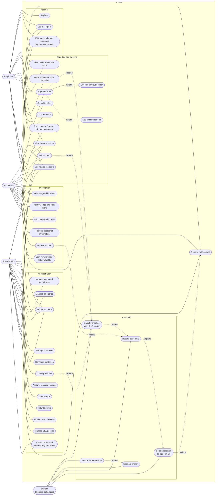
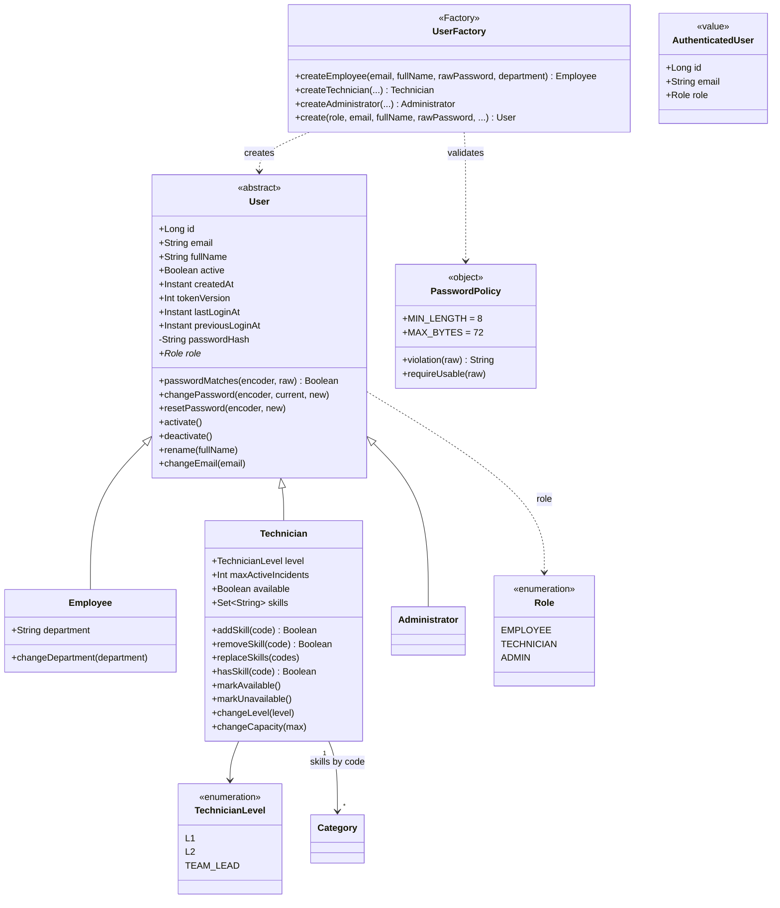
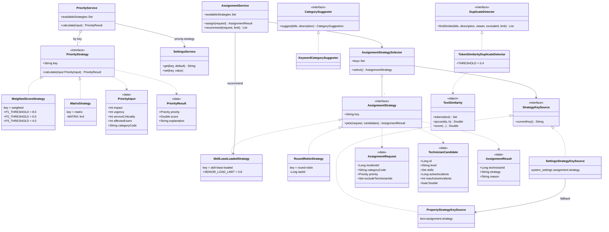
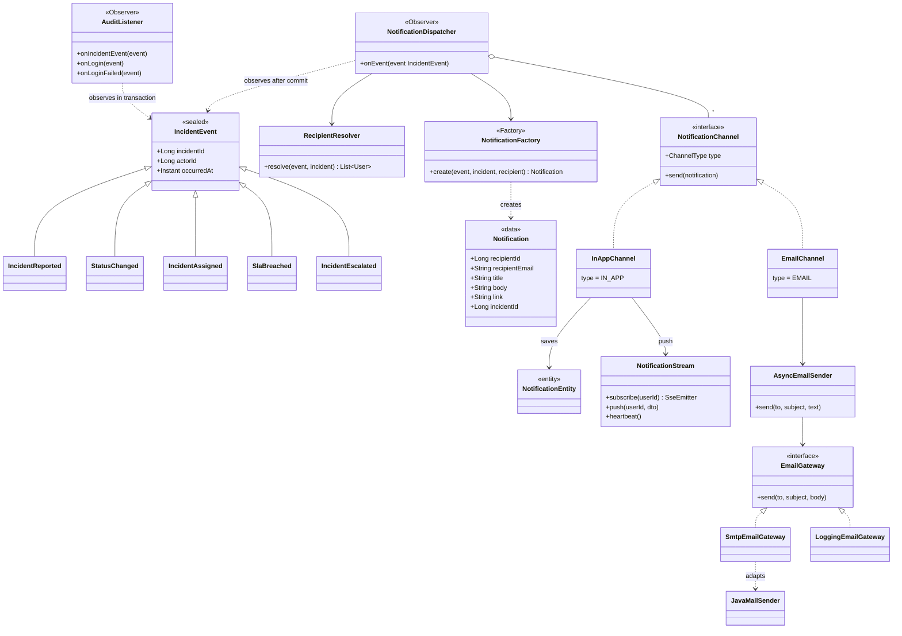
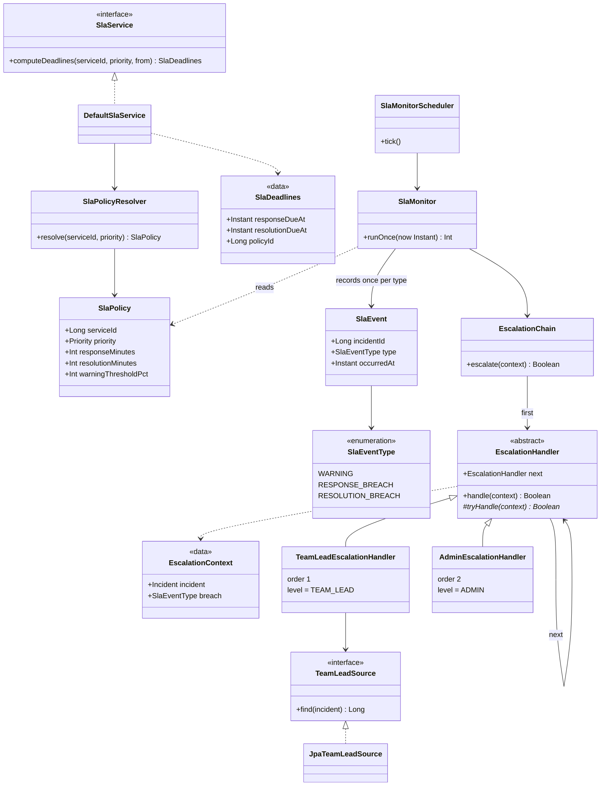
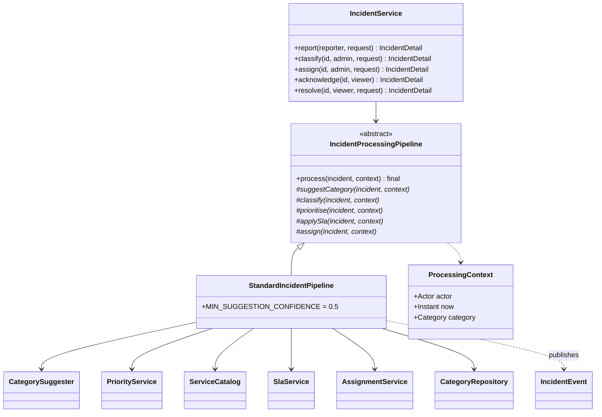
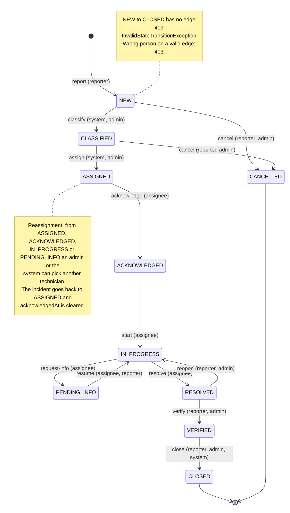
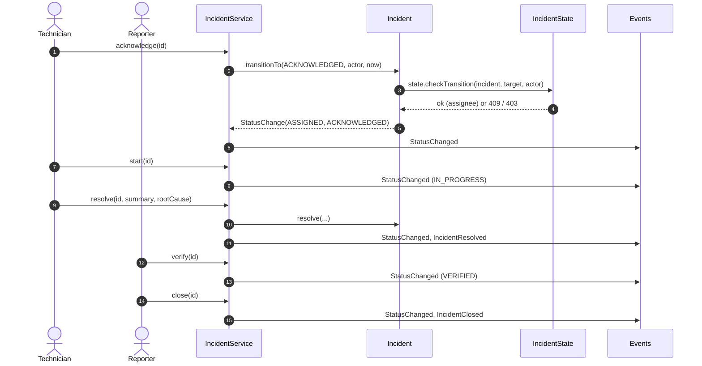

# 4. UML Diagrams

All diagrams are Mermaid and render on GitHub. They are derived from the code on `main`; class and method names are
the real ones. Diagrams show the members that matter for the design, not every getter.

## 4.1 Use case diagram

Four actors: the three human roles and the **System** (the scheduler and the automatic pipeline). Use cases inside
the boundary are rounded boxes; the lines show who can start them. `<<include>>` and `<<extend>>` are drawn as dotted
labelled arrows.

Notes:

* Technicians use the reporting use cases too when they report an incident themselves (UC4 and the reporter actions).
* UC27 (monitor SLA violations) is served by the overview and SLA-compliance reports, the `slaStatus` search filter and
  the admin SLA monitor page (UC38), which also lists clusters of similar open incidents.
* UC34 (edit incident): which fields a person may change depends on role and status (section 2.4, BR-08); an edit that
  touches impact, urgency, affected users or service re-runs the priority and SLA steps (so it includes UC28).
* "Manage IT services" (UC20) and "Manage SLA policies" (UC36) have API endpoints and admin pages (`/admin/services`, `/admin/sla`).
* UC10 for an administrator means verifying, reopening or closing on behalf of the reporter (`REPORTER_OR_ADMIN`).
* UC35 is for technicians only; UC37 shows incidents of the same cluster that the viewer is allowed to see.

## 4.2 Class diagram: users

Single-table inheritance: one `users` table, discriminator column `role` (`EMPLOYEE`, `TECHNICIAN`, `ADMIN`). The
password hash is private; callers can only verify or replace it through methods.

`AuthenticatedUser` is the per-request projection built from the validated token (`UserJwtAuthenticationConverter`);
services receive it instead of the entity.

## 4.3 Class diagram: incident domain

`Incident` is the aggregate root. It does not know which status-specific rules apply: it delegates to the
`IncidentState` object for its current status (State pattern). People are referenced by id. `Actor` says who is acting
and `Party` says which role that actor plays on this incident.

```mermaid
classDiagram
    class Incident {
        <<aggregate root>>
        +Long id
        +String number
        +String title
        +String description
        +Long reporterId
        +Long assigneeId
        +String categoryCode
        +Long serviceId
        +Impact impact
        +Urgency urgency
        +Int affectedUsers
        +Priority priority
        +Double priorityScore
        +String priorityExplanation
        +IncidentStatus status
        +Instant responseDueAt
        +Instant resolutionDueAt
        +Instant acknowledgedAt
        +Instant resolvedAt
        +Instant closedAt
        +String resolutionSummary
        +String rootCause
        +Int feedbackRating
        +Long version
        +state IncidentState
        +isActing(actor, party) Boolean
        +isVisibleTo(actor) Boolean
        +availableTransitions(actor) Set
        +transitionTo(target, actor, now) StatusChange
        +classify(category, actor, now) StatusChange
        +assign(technicianId, actor, now) StatusChange
        +resolve(summary, rootCause, actor, now) StatusChange
        +applyPriority(priority, score, now, explanation) Priority
        +applySla(responseDueAt, resolutionDueAt, now)
        +submitFeedback(rating, comment, actor, now)
        +canGiveFeedback(actor) Boolean
        +editableFieldsFor(actor) Set
        +edit(edit, actor, now) EditResult
    }
    class IncidentEdit {
        <<data>>
        +String title
        +String description
        +Impact impact
        +Urgency urgency
        +Int affectedUsers
        +Long serviceId
        +Boolean clearService
    }
    class EditResult {
        <<data>>
        +List changed
        +affectsPriority Boolean
    }
    class EditField {
        <<enumeration>>
        TITLE
        DESCRIPTION
        IMPACT
        URGENCY
        AFFECTED_USERS
        SERVICE
    }
    Incident ..> IncidentEdit : edit
    Incident ..> EditResult : returns
    EditResult --> EditField
    class IncidentState {
        <<sealed>>
        +IncidentStatus status
        #transitions Map
        +allowedTransitions Set
        +canTransitionTo(target) Boolean
        +partiesFor(target) Set
        +availableTargets(incident, actor) Set
        +checkTransition(incident, target, actor)
        +of(status)$ IncidentState
    }
    class NewState
    class ClassifiedState
    class AssignedState
    class AcknowledgedState
    class InProgressState
    class PendingInfoState
    class ResolvedState
    class VerifiedState
    class ClosedState
    class CancelledState
    class IncidentStatus {
        <<enumeration>>
        NEW
        CLASSIFIED
        ASSIGNED
        ACKNOWLEDGED
        IN_PROGRESS
        PENDING_INFO
        RESOLVED
        VERIFIED
        CLOSED
        CANCELLED
        +isOpen Boolean
        +countsTowardWorkload Boolean
    }
    class Party {
        <<enumeration>>
        REPORTER
        ASSIGNEE
        ADMIN
        SYSTEM
    }
    class Actor {
        <<value>>
        +Long userId
        +Role role
        +isSystem Boolean
        +isAdmin Boolean
        +of(user)$ Actor
        +SYSTEM Actor
    }
    class IncidentNote {
        +Long id
        +Long incidentId
        +Long authorId
        +NoteType type
        +String body
        +Instant createdAt
    }
    class NoteType {
        <<enumeration>>
        INVESTIGATION
        INFO_REQUEST
        INFO_RESPONSE
        COMMENT
    }
    class Impact {
        <<enumeration>>
        INDIVIDUAL = 1
        TEAM = 2
        DEPARTMENT = 3
        ORGANISATION = 4
    }
    class Urgency {
        <<enumeration>>
        LOW = 1
        MEDIUM = 2
        HIGH = 3
        CRITICAL = 4
    }
    class Priority {
        <<enumeration>>
        P1
        P2
        P3
        P4
    }
    class StatusChange {
        <<value>>
        +IncidentStatus from
        +IncidentStatus to
    }
    class Category {
        +String code
        +String name
        +Boolean active
    }
    class ItService {
        +Long id
        +String code
        +String name
        +Int criticality
        +Boolean active
    }

    IncidentState <|-- NewState
    IncidentState <|-- ClassifiedState
    IncidentState <|-- AssignedState
    IncidentState <|-- AcknowledgedState
    IncidentState <|-- InProgressState
    IncidentState <|-- PendingInfoState
    IncidentState <|-- ResolvedState
    IncidentState <|-- VerifiedState
    IncidentState <|-- ClosedState
    IncidentState <|-- CancelledState
    Incident --> IncidentState : state, derived from status
    Incident --> IncidentStatus : status
    Incident ..> Actor : acts for
    IncidentState ..> Party : who may move
    Incident ..> Party : isActing
    Incident ..> StatusChange : returns
    Incident --> Impact
    Incident --> Urgency
    Incident --> Priority
    Incident "1" o-- "*" IncidentNote : thread, by incident_id
    IncidentNote --> NoteType
    Incident "*" --> "0..1" Category : categoryCode
    Incident "*" --> "0..1" ItService : serviceId
    Incident "*" --> "1" User : reporterId
    Incident "*" --> "0..1" Technician : assigneeId
```

The ten state classes are Kotlin `object`s (singletons): they hold no per-incident data, only the transition table.

## 4.4 Class diagram: strategies

Two Strategy families, each chosen at run time by a key. Both are open for extension: add a `@Component` that
implements the interface and it is picked up by the selector service.

`AssignmentStrategySelector` reads the key through `SettingsStrategyKeySource`, which uses the `assignment.strategy` setting
in `system_settings` and falls back to `PropertyStrategyKeySource` (`itsm.assignment.strategy`) (see section 5.3).

Incident correlation (`IncidentCorrelator`, a pure class grouping `CorrelationCandidate`s into `IncidentCluster`s) and
`IncidentCorrelationService` (loads open incidents, filters by what the viewer may see) are described in section 5.11.

## 4.5 Class diagram: notifications (Observer, Factory, Adapter)

`EmailGateway` is the target interface of the Adapter; `SmtpEmailGateway` adapts Spring's `JavaMailSender` to it.
`EmailGatewayConfig` selects the implementation from `itsm.mail.gateway` (`smtp` or `logging`).

## 4.6 Class diagram: SLA and escalation chain

The chain is Technician (the current assignee) to Team Lead to Administrator. `TeamLeadEscalationHandler` (order 1)
handles the response breach of an incident nobody acknowledged: `JpaTeamLeadSource` picks an active, available team
lead (preferring the category skill, then the lowest load) and the incident is **reassigned** to that person with
`Actor.SYSTEM`; it publishes `IncidentEscalated(level TEAM_LEAD)`, `IncidentAssigned(strategy "escalation")` and, when
the status changed, `StatusChanged`. `AdminEscalationHandler` (order 2) is the last link: it publishes
`IncidentEscalated(level ADMIN)` for a P1/P2 resolution breach, or for an unacknowledged response breach for which no
team lead could take over. `SlaMonitor` calls the chain once per incident and breach type.

Beside the monitor, `SlaRiskDetector` is a pure class that classifies an open incident as `BREACHED` or `AT_RISK`
(`SlaRiskState`), used by `SlaRiskService` for `GET /api/admin/sla/at-risk` and by `TechnicianWorkloadService`.

## 4.7 Class diagram: report pipeline (Template Method)

## 4.8 State diagram: incident lifecycle

Derived directly from the transition tables in `IncidentState.kt`; edge labels are the parties allowed to make the move
(`SYSTEM_OR_ADMIN`, `REPORTER_OR_ADMIN`, and so on). Reassignment (an administrator or the system giving an active
incident to another technician) is drawn separately because it is not a transition of its own (`Incident.assign`).

## 4.9 Sequence diagram: lifecycle after assignment

