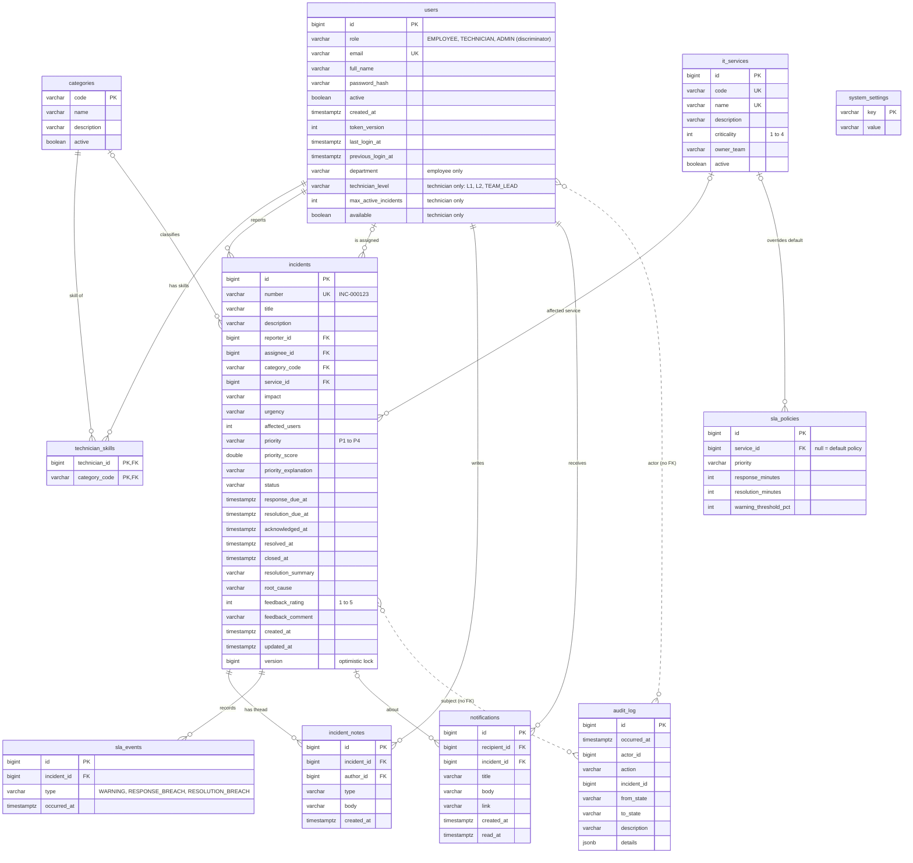

# 7. Database Design

The database is **PostgreSQL 17**. The schema is owned by Flyway migrations in
`backend/src/main/resources/db/migration`; Hibernate runs with `ddl-auto: validate`, so the entities must match the
migrations or the application will not start.

## 7.1 Migrations

| File | Adds |
|---|---|
| `V20261103_1200__create_users.sql` | `users` (single table for all roles), `technician_skills` |
| `V20261112_1200__auth_session_tracking.sql` | `users.token_version`, `last_login_at`, `previous_login_at` |
| `V20261115_1200__incident_core.sql` | `categories` (+9 seeded rows), foreign key from `technician_skills`, sequence `incident_number_seq`, `incidents`, `incident_notes` |
| `V20261118_1100__sla_reference_tables.sql` | minimal `it_services`, foreign key `incidents.service_id`, minimal `sla_events` |
| `V20261118_1200__audit_and_notifications.sql` | `audit_log`, `notifications` |
| `V20261118_1300__service_catalog_and_sla.sql` | extends `it_services` (+8 seeded services), adds `sla_policies` (+4 default rows), `system_settings` (+2 rows), unique `(incident_id, type)` on `sla_events` |
| `V20261118_1400__incident_priority_explanation.sql` | `incidents.priority_explanation` |

**Naming.** `V<yyyymmdd>_<hhmm>__<description>.sql`. Timestamps rather than counters mean five people can add
migrations in parallel without two of them both creating "V3". A merged migration is never edited; fixes are new
migrations (this is why the SLA tables were first created in minimal form and then extended with `ALTER TABLE`).
The later feature work (SLA policy administration, incident editing, escalation levels, correlation, SLA risk) needed no schema
change: `sla_policies`, `incidents` and `audit_log` already held what they use (escalation levels are recorded in the
`INCIDENT_ESCALATED` audit entry, clusters and risk are computed on request).

## 7.2 Entity-relationship diagram

`audit_log` has no foreign keys on purpose (history must survive deletion of users or incidents, and login events have
no incident); its logical references are drawn dotted.



Important relationships:

* **User to incident, twice.** `reporter_id` (required) and `assignee_id` (optional) both reference `users(id)`.
* **Incident to category and service** are optional (a NEW incident may have neither).
* **`sla_policies.service_id` null** means the default policy for that priority.
* **Notes, SLA events and notifications cascade on delete** of the incident (they are meaningless without it);
  skills cascade with the technician; SLA policies cascade with the service.
* **Settings** are a key/value table, not related to others.

## 7.3 Table-by-table summary

### `users`

One table for the whole `User` hierarchy (single-table inheritance, discriminator `role`). Subtype columns
(`department`, `technician_level`, `max_active_incidents`, `available`) are nullable.

* Constraints: `uq_users_email`; `ck_users_role` (three roles); `ck_users_technician_level` (L1, L2, TEAM_LEAD);
  `ck_users_max_active_incidents` (> 0); `ck_users_technician_columns` (a TECHNICIAN row must have level, capacity and
  availability).
* Why single-table: three small subtypes that are always loaded together; a query for "all users" needs no joins and
  the discriminator makes polymorphic queries trivial. The check constraint restores the integrity that separate tables would give.
* Session columns: `token_version` (revocation), `last_login_at`, `previous_login_at`; only changed by dedicated atomic
  SQL, never by the entity (`insertable = false, updatable = false`).
* Emails are stored trimmed and lower-case (entity), so the unique index is case-insensitive in effect.

### `technician_skills`

`(technician_id, category_code)` primary key; `technician_id` cascades; `category_code` references `categories(code)`
(added in the incident migration, where skills that predate categories were imported as inactive categories). Index
`idx_technician_skills_category_code` supports "who has this skill" queries.

### `categories`

Natural key `code` (upper case, `ck_categories_code_upper`), `name`, `description`, `active`. Never deleted, only
deactivated, so old incidents and skills keep a valid reference.

### `it_services`

IT service catalog: `code` (unique), `name` (unique), `description`, `criticality` 1 to 4 (check), `owner_team`, `active`.
Referenced by incidents and SLA policies. Never deleted, only deactivated. Criticality feeds priority calculation.

### `incidents`

The core table; mirrors the `Incident` entity.

* Identity: `id` (identity), `number` unique (`INC-000123` from `incident_number_seq`, generated by
  `IncidentNumberGenerator`, safe across instances).
* Foreign keys: `reporter_id`, `assignee_id` to `users`; `category_code` to `categories`; `service_id` to `it_services`.
* Check constraints mirror the enums: impact, urgency, priority, status, `affected_users >= 1`, `feedback_rating`
  between 1 and 5. A bug that wrote an invalid status would be rejected by the database too.
* Lifecycle timestamps: `acknowledged_at`, `resolved_at`, `closed_at`; SLA deadlines `response_due_at`,
  `resolution_due_at`; resolution data `resolution_summary`, `root_cause`; `feedback_*`.
* `version` is the optimistic-lock counter (`@Version`).
* Indexes: `idx_incidents_reporter (reporter_id, created_at desc)` for "my incidents"; `idx_incidents_assignee_status
  (assignee_id, status)` for the technician queue and workload counts; `idx_incidents_status`;
  `idx_incidents_category`; `idx_incidents_created_at` for date filters and the trend report.

### `incident_notes`

Append-only thread: `type` (INVESTIGATION, INFO_REQUEST, INFO_RESPONSE, COMMENT, check constraint), `body`,
`author_id`, `created_at`. Index `idx_incident_notes_incident (incident_id, created_at)`. Cascades with the incident.

### `sla_policies`

`(service_id, priority)` unique plus a partial unique index `uq_sla_policies_default_priority on (priority) where
service_id is null`, because a plain unique constraint treats nulls as distinct and would allow two default rows.
Checks: priority in P1 to P4; `response_minutes > 0`; `resolution_minutes >= response_minutes`;
`warning_threshold_pct` between 1 and 99 (default 75).

### `sla_events`

One row per `(incident_id, type)` (`uq_sla_events_incident_type`): the monitor relies on this for idempotency, so
running it twice, or concurrently, records each warning or breach once. Index `idx_sla_events_incident_type`.
Used by the SLA-status search filter and the SLA reports.

### `system_settings`

Key/value runtime configuration (`priority.strategy`, `assignment.strategy`). Keys are validated by
`SettingsAdminService`.

### `audit_log`

`occurred_at`, `actor_id` (null = system or unknown), `action` (for example `STATUS_CHANGED`), `incident_id` (null for
login events), `from_state`, `to_state`, `description`, `details` (JSONB). No foreign keys, deliberately.
Indexes on `(incident_id, occurred_at)`, `actor_id`, `action`, `occurred_at` support the timeline and the admin
filters. Rows are only ever inserted.

### `notifications`

In-app inbox: `recipient_id` (cascade), `incident_id` (cascade), `title`, `body`, `link`, `created_at`, `read_at`.
Indexes `idx_notifications_recipient (recipient_id, read_at)` (unread lists and counts) and
`idx_notifications_incident`.

## 7.4 Sample data

### Seeded by migrations (every environment)

**Categories** (`categories`): HARDWARE, SOFTWARE, NETWORK, DATABASE, CLOUD, SECURITY, AUTHENTICATION, APPLICATION,
STORAGE (each with a one-line description, all active).

**IT services** (`it_services`):

| code | name | criticality | owner team |
|---|---|---|---|
| PAYMENT | Payment | 4 | Payments |
| EMAIL | Email | 2 | Workplace |
| VPN | VPN | 3 | Network |
| DATABASE | Database | 4 | Platform |
| AUTH | Authentication | 4 | Security |
| STORAGE | Cloud Storage | 2 | Platform |
| HR | HR Portal | 1 | Business Apps |
| WEBSITE | Website | 3 | Web |

**Default SLA policies** (`sla_policies`, `service_id` null, warning at 75 %):

| priority | response (min) | resolution (min) |
|---|---|---|
| P1 | 5 | 30 |
| P2 | 15 | 120 |
| P3 | 60 | 480 |
| P4 | 240 | 1440 |

**Settings** (`system_settings`): `priority.strategy = weighted`, `assignment.strategy = skill-least-loaded`.

### Created at start-up from configuration

* **Administrator** from `ADMIN_EMAIL` / `ADMIN_PASSWORD` (`AdminBootstrap`; docker compose defaults
  `admin@itsm.local` / `ChangeMe123!`).
* **Demo data** with `DEMO_DATA=true` (`DemoDataSeeder`, development only, all passwords `ChangeMe123!`):

| Email | Name | Role | Level | Skills |
|---|---|---|---|---|
| `employee@itsm.local` | Erin Employee (Finance) | EMPLOYEE | | |
| `employee2@itsm.local` | Marco Marketing | EMPLOYEE | | |
| `employee3@itsm.local` | Priya People (Human Resources) | EMPLOYEE | | |
| `tech1@itsm.local` | Tariq Network | TECHNICIAN | L2 | NETWORK, AUTHENTICATION, SECURITY |
| `tech2@itsm.local` | Sofia Software | TECHNICIAN | L1 | SOFTWARE, APPLICATION, DATABASE |
| `tech3@itsm.local` | Hugo Hardware | TECHNICIAN | TEAM_LEAD | HARDWARE, CLOUD, STORAGE |
| `tech4@itsm.local` | Dana Database | TECHNICIAN | L2 | DATABASE, APPLICATION, CLOUD, SECURITY |
| `tech5@itsm.local` | Leo Helpdesk | TECHNICIAN | L1 | HARDWARE, SOFTWARE, AUTHENTICATION, NETWORK, STORAGE |

and 24 incidents reported by the three employees, created through the real `IncidentService` so priority, SLA,
assignment, audit rows and notifications exist. They cover the services (Payment, VPN, Email, Storage, Auth, Website,
HR, Database), all four priorities and every lifecycle state (NEW, ASSIGNED, IN_PROGRESS, PENDING_INFO, RESOLVED and
CLOSED with feedback ratings). Examples:

| Title | Reporter | What it shows |
|---|---|---|
| VPN drops every few minutes | Erin | IN_PROGRESS with Tariq, at risk of its SLA |
| Laptop battery is swollen | Erin | assigned to Hugo, response SLA breached |
| Website contact form returns an error | Marco | IN_PROGRESS with Dana, SLA breached |
| Cannot send email to external clients | Marco | PENDING_INFO, at risk |
| Something odd on my screen | Erin | no keywords, stays NEW for an administrator to classify |
| Excel crashes on large files | Erin | RESOLVED, waiting for the reporter to confirm |
| Docking station does not charge the laptop | Erin | CLOSED with rating 5 (older work feeds the trend and mean-time-to-resolve reports) |
| four incidents for the Payment service | Marco, Priya, Erin | reported within the last hour: a cluster for the correlation view |

The seeder moves the SLA deadlines of a few incidents into the past with JDBC (the creation time is immutable in the
domain) and runs the SLA monitor once, so that two breached and several at-risk incidents exist from the first minute.
It is idempotent per user and incident title, and refuses to run under the `prod` profile. `DemoDataSeederTest`
checks the counts and the idempotence.

### Example rows

```sql
-- an incident (simplified) as stored after the pipeline ran
INC-000001 | VPN drops every few minutes | reporter_id=2 | assignee_id=3 | category_code=NETWORK
priority=P3 | priority_score=4.8 | status=IN_PROGRESS
response_due_at = created_at + 60 min | resolution_due_at = created_at + 480 min

-- its audit trail
INCIDENT_REPORTED, INCIDENT_CLASSIFIED, STATUS_CHANGED NEW to CLASSIFIED, PRIORITY_CHANGED unset to P3,
INCIDENT_ASSIGNED (strategy skill-least-loaded), STATUS_CHANGED CLASSIFIED to ASSIGNED,
STATUS_CHANGED ASSIGNED to ACKNOWLEDGED, STATUS_CHANGED ACKNOWLEDGED to IN_PROGRESS
```

(Scores are computed from the formula in chapter 5 with impact, urgency and the default criticality 2; the demo incidents have no service.)

## 7.5 Persistence notes

* **Optimistic locking.** `Incident` has `@Version` (`incidents.version`). Two people saving the same incident at the
  same time cannot silently overwrite each other: the loser gets `ObjectOptimisticLockingFailureException`, which
  `GlobalExceptionHandler` turns into 409 `ConcurrentUpdate`. `@DynamicUpdate` writes only changed columns.
* **Time.** All instants are `timestamptz` and `java.time.Instant` (UTC). Entities truncate to microseconds so a value
  returned by a POST equals the same value read later. Date filters and the trend report use UTC days; run the
  database in UTC.
* **Enums as strings.** Status, priority, impact, urgency, roles and note types are stored as text with matching check
  constraints (`@Enumerated(EnumType.STRING)`), so reordering an enum never changes stored data. The behaviour of a
  status lives in code (`IncidentState`), not in the database.
* **Identity.** `bigint generated always as identity` for most tables; `incident_number_seq` for human-readable numbers.
* **Transactions.** One transaction per use case (`IncidentService` is `@Transactional`); audit rows join it,
  notifications use new transactions after commit.
* **Soft deletion.** Users, categories and services are deactivated rather than deleted so history stays valid.
* **Atomic counters.** `users.token_version` is incremented with a single SQL `update ... set token_version =
  token_version + 1` (`SessionRevoker`), so concurrent revocations cannot lose an update.
* **Open session in view is disabled** (`spring.jpa.open-in-view: false`): services return DTOs inside their
  transaction (`IncidentAssembler`), which avoids lazy-loading surprises and N+1 queries (batch fetching of 50 is set).
* **Reporting queries** aggregate in the database (`avg`, `group by`, `count(distinct)`).
