# 8. Exception Handling and Security

## 8.1 Exception hierarchy (backend)

All application errors extend `ItsmException` (`common/exception/ItsmException.kt`), a `RuntimeException` that carries
an HTTP status. `GlobalExceptionHandler` (`web/GlobalExceptionHandler.kt`, a `@RestControllerAdvice`) converts it to an
RFC 9457 `application/problem+json` response (`ProblemDetail`) whose `title` is the exception's class name. Domain code
therefore throws meaningful exceptions and never builds HTTP responses.

```mermaid
classDiagram
    class RuntimeException
    class ItsmException {
        <<abstract>>
        +HttpStatus status
    }
    RuntimeException <|-- ItsmException

    class NotFoundException
    NotFoundException : +status 404
    class DomainValidationException
    DomainValidationException : +status 400
    class InvalidSearchException
    InvalidSearchException : +status 400
    class NotificationNotFoundException
    NotificationNotFoundException : +status 404

    class InvalidCredentialsException
    InvalidCredentialsException : +status 401
    class UnauthenticatedException
    UnauthenticatedException : +status 401
    class AccountDisabledException
    AccountDisabledException : +status 403
    class UnauthorizedOperationException
    UnauthorizedOperationException : +status 403
    class TooManyLoginAttemptsException
    TooManyLoginAttemptsException : +status 429

    class IncorrectPasswordException
    IncorrectPasswordException : +status 400
    class UserNotFoundException
    UserNotFoundException : +status 404
    class EmailAlreadyRegisteredException
    EmailAlreadyRegisteredException : +status 409
    class CannotDeactivateSelfException
    CannotDeactivateSelfException : +status 400
    class InvalidUserUpdateException
    InvalidUserUpdateException : +status 400
    class UnknownSkillException
    UnknownSkillException : +status 400

    class IncidentNotFoundException
    IncidentNotFoundException : +status 404
    class InvalidStateTransitionException
    InvalidStateTransitionException : +status 409
    class InvalidIncidentOperationException
    InvalidIncidentOperationException : +status 409
    class CategoryConflictException
    CategoryConflictException : +status 409
    class ServiceConflictException
    ServiceConflictException : +status 409
    class SlaNotConfiguredException
    SlaNotConfiguredException : +status 500

    ItsmException <|-- NotFoundException
    ItsmException <|-- DomainValidationException
    ItsmException <|-- InvalidSearchException
    ItsmException <|-- NotificationNotFoundException
    ItsmException <|-- InvalidCredentialsException
    ItsmException <|-- UnauthenticatedException
    ItsmException <|-- AccountDisabledException
    ItsmException <|-- UnauthorizedOperationException
    ItsmException <|-- TooManyLoginAttemptsException
    ItsmException <|-- IncorrectPasswordException
    ItsmException <|-- UserNotFoundException
    ItsmException <|-- EmailAlreadyRegisteredException
    ItsmException <|-- CannotDeactivateSelfException
    ItsmException <|-- InvalidUserUpdateException
    ItsmException <|-- UnknownSkillException
    ItsmException <|-- IncidentNotFoundException
    ItsmException <|-- InvalidStateTransitionException
    ItsmException <|-- InvalidIncidentOperationException
    ItsmException <|-- CategoryConflictException
    ItsmException <|-- ServiceConflictException
    ItsmException <|-- SlaNotConfiguredException
```

| Exception | Package | Status | Thrown when |
|---|---|---|---|
| `DomainValidationException` | `common.exception` | 400 | a domain invariant fails (`domainRequire`): blank title, impact outside 1 to 4, unknown or inactive service or category, assigning to the reporter |
| `NotFoundException` | `common.exception` | 404 | generic missing resource |
| `InvalidSearchException` | `common.exception` | 400 | search `from` after `to`, unknown sort field, `days` outside 1 to 365 |
| `NotificationNotFoundException` | `common.exception` | 404 | marking another user's or a missing notification |
| `InvalidCredentialsException` | `auth` | 401 | wrong password or unknown email (same message for both) |
| `UnauthenticatedException` | `auth` | 401 | `CurrentUser.get()` without a logged-in user |
| `AccountDisabledException` | `auth` | 403 | correct password for a deactivated account |
| `UnauthorizedOperationException` | `auth` | 403 | wrong role for a lifecycle move, not allowed to see an incident, reassigning without admin rights |
| `TooManyLoginAttemptsException` | `auth` | 429 | more than 5 attempts per email in the window; response has `Retry-After` |
| `IncorrectPasswordException` | `user` | 400 | wrong current password when changing it |
| `UserNotFoundException` | `user` | 404 | unknown user id |
| `EmailAlreadyRegisteredException` | `user` | 409 | duplicate email (also translated from the database's `uq_users_email` violation) |
| `CannotDeactivateSelfException` | `user` | 400 | administrator deactivating themselves |
| `InvalidUserUpdateException` | `user` | 400 | field not valid for the role (for example level on an employee) |
| `UnknownSkillException` | `user` | 400 | skill is not an active category code |
| `IncidentNotFoundException` | `incident` | 404 | unknown incident id |
| `InvalidStateTransitionException` | `incident` | 409 | lifecycle has no such move (carries `from` and `to`) |
| `InvalidIncidentOperationException` | `incident` | 409 | not possible now: feedback before resolution or twice, `transitionTo(CLASSIFIED)` |
| `CategoryConflictException` | `category` | 409 | duplicate category code |
| `ServiceConflictException` | `service` | 409 | duplicate service code or name (also when concurrent) |
| `SlaNotConfiguredException` | `sla` | 500 | no policy for a priority (not even the default); only if seeded defaults were deleted |

Other conditions mapped by `GlobalExceptionHandler`:

| Condition | Response |
|---|---|
| `MethodArgumentNotValidException` (Bean Validation on a request body) | 400, title `ValidationError`, detail "Validation failed", property `errors` = `{field: message}` |
| `HttpMessageNotReadableException` (malformed or missing JSON) | 400 "Malformed or unreadable request body" |
| `MethodArgumentTypeMismatchException` (bad path or query value) | 400 "Invalid value for parameter 'x'" |
| `MissingServletRequestParameterException` | 400 "Missing required parameter 'x'" |
| `ObjectOptimisticLockingFailureException` (stale `Incident.version`) | 409, title `ConcurrentUpdate`, "The record was changed by someone else. Reload and try again." |
| `AccessDeniedException` (including `@PreAuthorize` denials) | 403 "Access denied" |
| Missing, invalid or expired JWT | 401 from `SecurityConfig.authenticationEntryPoint`, with `WWW-Authenticate: Bearer`, as problem+json |
| Authenticated but forbidden by URL rule | 403 from `SecurityConfig.accessDeniedHandler`, as problem+json |
| Anything else (for example a database outage) | container-generated 500; `server.error.include-message: never` stops internals leaking |

Design points:

* **Two kinds of "no" are kept apart**: 409 means the lifecycle has no such move whoever asks; 403 means the move exists
  but not for this person (`IncidentState.checkTransition`).
* **Failure isolation** is part of exception design: `NotificationDispatcher` catches and logs per recipient and per
  channel (a failing email never fails the user's action); `SlaMonitor` catches per incident (a missing policy for one
  incident does not stop the others); `AsyncEmailSender` falls back to logging when the gateway fails; the demo seeder
  logs and continues; `LastLoginRecorder` swallows its own failures.
* **No stack traces or messages from unexpected exceptions reach the client.**
* Unknown configuration is tolerated with a warning rather than a crash where that is safe (unknown strategy keys fall back to the
  default; a `warned` set logs each bad key once).

The brief's list of situations is mapped in [02-requirements.md](02-requirements.md), section 2.6.

## 8.2 Frontend error handling

| Piece | File | Behaviour |
|---|---|---|
| `ApiError` | `src/lib/errors.ts` | Parsed from `problem+json` (`status`, `title`, `detail`, `fieldErrors`, `retryAfterSeconds`); tolerates non-JSON bodies (such as an HTML error page from a proxy) and wrong shapes. `userMessage` shows the backend `detail` for client errors but a generic message for 5xx or an unreachable backend, so server internals are never displayed. |
| Typed client | `src/lib/backend.ts` (`BackendClient`) | Every call has a timeout (`BACKEND_TIMEOUT_MS`, default 5000); network failure or timeout becomes an unreachable `ApiError` (502); an answer that is not JSON, or a `/me` or login answer that is not a user, becomes a 502 `ApiError`. |
| Page reaction | `src/lib/loadError.ts` (`handleLoadError`) | 404 to the 404 page; 401 ends the session and redirects to `/login?next=...&expired=1`; 403 to the 403 page; 5xx or unreachable to the 503 page (or inline for forms, `inlineServerErrors`); any other `ApiError` is returned for display; non-`ApiError`s are rethrown (bugs are not hidden). |
| Form errors | `src/lib/forms.ts` (`formErrorState`) | Maps `fieldErrors` onto fields (`FormField`, `TextAreaField`) and a page-level message (`Alert`). Forms re-render with the user's input preserved. |
| Middleware | `src/lib/gate.ts` | Backend down on a protected path rewrites to `/503` (no misleading redirect to login) and keeps the cookie; a 401 from `/me` clears the cookie. |
| Proxy | `src/pages/api/[...path].ts` | Returns `problem+json` itself for 400 (bad path), 403 (cross-origin write), 413 (body over 1 MiB), 502 (unreachable), 504 (timeout, 15 s). |
| Login | `src/lib/loginMessages.ts` | 429 shows "Too many failed attempts. Try again in N minutes." from `Retry-After`; 400 a fixed hint; other errors the backend message; server errors hidden. |
| Notices | login and account pages | Success and expiry notices are chosen from a fixed set by flag (`expired=1`, `loggedOut=all`, `registered=1`, `?notice=...`); query text is **never echoed**. |
| Error pages | `403.astro`, `404.astro`, `503.astro`, `ErrorPage.astro` | Friendly pages with a way back. |

## 8.3 Security

The brief requires authentication, role-based authorisation, password protection, input validation, secure API access
and protection against unauthorised operations, and asks that considerations are documented. The measures:

### Authentication and passwords

| Measure | Detail | Code |
|---|---|---|
| Password hashing | `DelegatingPasswordEncoder` (BCrypt by default, stored with an `{id}` prefix so the algorithm can be upgraded). The hash column is private on `User`; `toString` never prints it. | `SecurityConfig.passwordEncoder`, `User.passwordHash` |
| Password policy | 8 to 72 characters and at most 72 UTF-8 bytes (BCrypt ignores everything after 72 bytes, so longer input is rejected rather than silently truncated). `passwordMatches` treats an over-long input as non-matching while still doing one hash comparison. | `PasswordPolicy`, `User.passwordMatches`, `BcryptLimitTest` |
| Uniform failure | Unknown email and wrong password give the same 401 and message; for an unknown email a dummy hash is checked so response time does not reveal whether the account exists. | `AuthService.login` |
| Login throttling | Every attempt for an email (normalised) is counted before any hashing; 5 attempts without a success lock that email for 15 minutes (429 plus `Retry-After`), even with the right password. A success clears the counter. Unknown emails are tracked identically. Memory is bounded (10,000 emails, least-recently-used eviction). Limitations: in memory, per instance, and anyone can lock a known email by failing on purpose. | `LoginAttemptTracker`, `LoginThrottleApiTest` |
| Bootstrap admin | Created only when none exists, from environment variables; a password that violates the policy stops start-up with a clear message. Registration can never create anything but an Employee. | `AdminBootstrap`, `AuthController.register` |

### Tokens and sessions

| Measure | Detail | Code |
|---|---|---|
| JWT | HS256, claims `sub`, `email`, `name`, `role`, `ver`, `iss`, `iat`, `exp`; default TTL 8 h (`JWT_TTL`). The backend refuses to start without a secret of at least 32 bytes. Validator checks signature, expiry and issuer. | `JwtTokenService`, `SecurityConfig.jwtDecoder` |
| Current data wins | On every request `UserJwtAuthenticationConverter` loads the user from the database: a deactivated or deleted account gets 401 immediately, and email and role come from the database, not from the token. | `UserJwtAuthenticationConverter`, `AuthApiTest` |
| Revocation | `users.token_version` must equal the token's `ver` claim. It is incremented atomically on password change, admin reset, deactivation and `POST /api/auth/logout-all`; changing your own password returns a fresh token so you stay signed in. | `SessionRevoker`, `SessionRevocationTest` |
| Stateless | No server session, `SessionCreationPolicy.STATELESS`. | `SecurityConfig` |

### Transport between browser and API (frontend)

| Measure | Detail | Code |
|---|---|---|
| httpOnly cookie | Cookie `itsm_session`: `HttpOnly`, `SameSite=Lax`, `Path=/`, expiry = token expiry, `Secure` when `COOKIE_SECURE=true`. Browser JavaScript can neither read nor steal the token (XSS cannot exfiltrate it). | `src/lib/session.ts` |
| CSRF (three layers) | (1) `SameSite=Lax` cookie; (2) Astro `security.checkOrigin: true` rejects cross-origin form posts to pages; (3) the `/api` proxy rejects unsafe methods when `Sec-Fetch-Site` is `cross-site` or `same-site`, when `Origin` differs from its own, or when (without `Origin`) `Referer` is foreign. Requests with none of these headers (curl) are allowed because they cannot ride on a victim's cookie. The backend itself disables Spring's CSRF filter because it only accepts bearer tokens, not cookies. | `astro.config.mjs`, `src/lib/csrf.ts`, `SecurityConfig` |
| Proxy allow-lists | Request headers forwarded: only `Accept`, `Accept-Language`, `Content-Type`, `If-None-Match`, `If-Modified-Since`, plus `Authorization` built from the cookie. Never the browser's `Cookie`. Response headers passed back: `content-type`, `cache-control`, `etag`, `last-modified`, `content-disposition`, `www-authenticate`, `retry-after`, `vary` and a safe `Location`. Never `Set-Cookie`. | `src/lib/proxy.ts` |
| Path rules | Wildcard paths containing `\`, `%`, `?`, `#`, control characters or an empty, `.` or `..` segment give 400 and the final URL must stay on the backend origin under `/api/`, so a request cannot leave the API tree. | `proxyTarget` |
| Resource limits | Request bodies over 1 MiB give 413 (checked on `Content-Length` and while streaming); proxy timeout 15 s (504); backend client timeout 5 s. | `proxy.ts`, `api/[...path].ts` |
| Open redirects | `next=` after login is validated (`safeNext`: local paths only). | `src/lib/redirect.ts` |
| Route rules | `ROUTE_RULES` in `src/lib/access.ts`: `/admin` for ADMIN only; `/dashboard`, `/account`, `/notifications`, `/search`, `/incidents` for any logged-in user; everything else public. Matching normalises case, encoding, repeated slashes and `.`/`..` so variants cannot slip past. This is a convenience layer; the backend enforces the real rules. | `access.ts`, `gate.ts`, `access.test.ts` |

### Authorisation (backend)

Authorisation is layered, from coarse to fine:

1. **URL rules** in `SecurityConfig`: public: `/api/auth/login`, `/api/auth/register`, `/api/ping`, `/actuator/health/**`,
   OpenAPI and Swagger UI; `/api/admin/**` requires `ROLE_ADMIN`; everything else needs authentication.
2. **Method rules**: `@PreAuthorize("hasRole('ADMIN')")` (with `@EnableMethodSecurity`) on the admin controllers, the
   reports and the audit search, so protection survives a changed URL layout.
3. **Domain rules**: the lifecycle table in `IncidentState` says who (`Party`) may make each move;
   `Incident.isVisibleTo` says who may read; `noteTypesFor` says who may write which note; `requireAdmin` guards
   classification and assignment in the service. A wrong role gets 403, an impossible move gets 409.
4. **Query-level visibility**: search and duplicate hints filter in the query (`IncidentSpecifications.visibleTo`) and
   the detector re-checks each row, so titles of invisible incidents never leak. The incident history endpoint applies
   `isVisibleTo`; INVESTIGATION notes are visible only to assignee and administrators, even if the viewer reported the
   incident.
5. **UI**: `IncidentDetail.actions` lists only permitted actions computed by the same domain rules, so the UI and API cannot disagree.

### Input validation and output safety

* **Boundary validation**: Bean Validation (`@NotBlank`, `@Size`, `@Min`, `@NotNull`, custom `@ValidPassword`) on every
  request DTO (for example `ReportIncidentRequest`: title at most 200, description at most 4000, affected users at least
  1, category code at most 100). Failures are 400 with per-field messages.
* **Domain validation**: entities re-check their invariants (`domainRequire`), so a bug in a controller cannot create
  an invalid incident. The database adds check constraints as a third layer.
* **Normalisation**: emails trimmed and lower-cased; category and skill codes upper-cased; text trimmed.
* **SQL injection**: all queries are parameterised (Spring Data, JPQL with named parameters, Criteria
  Specifications). Search `LIKE` filters escape `%`, `_` and `\` (`ESCAPE` in `IncidentSpecifications`; tests
  `list q treats percent and underscore literally` and related in `AdminUserApiTest`).
* **XSS**: Astro escapes every interpolated expression by default and the code base does not use `set:html`;
  the one script that renders backend text (`incident-suggest.js`) builds the DOM with `textContent`, never
  `innerHTML`; messages shown after redirects come from a fixed set, never from the URL; the audit log stores typed login
  emails with control characters removed and cut to 100 characters (`AuditListener.sanitize`).
* **Mass assignment**: DTOs list only the allowed fields; `PATCH /api/auth/me` ignores `email` and `role`; registration
  ignores a `role` field.
* **Information disclosure**: `ApiError.userMessage` hides server details; the proxy hides backend headers;
  `server.error.include-message: never`.
* **Auditing**: logins, failed logins and every incident action are recorded (`audit_log`).

### CORS and configuration

* CORS allows only the configured frontend origin(s) (`CORS_ALLOWED_ORIGINS`), with credentials; in the normal
  deployment the browser talks to one origin anyway.
* Secrets (`JWT_SECRET`, passwords, SMTP credentials) come from environment variables; compose supplies an
  *insecure development* secret that must be replaced for any real deployment.
* Actuator exposes only `health` and `info`; the mail health check is disabled so an optional SMTP server cannot turn
  health DOWN.

### Known limitations (to be stated honestly in the report)

* HS256 means one shared secret; an asymmetric key or an identity provider (OIDC) would be the next step.
* The login throttle is in memory and per instance; locking a known email by failing on purpose is possible.
* Tokens already issued keep working during a throttle lockout and until expiry unless revoked.
* No TLS in the compose setup (put it behind a TLS-terminating proxy and set `COOKIE_SECURE=true`).
* No MFA, no password-reset-by-email (an administrator resets passwords).
* Without `Origin`, `Referer` and `Sec-Fetch-Site`, the proxy cannot distinguish a non-browser client; this is intentional.
